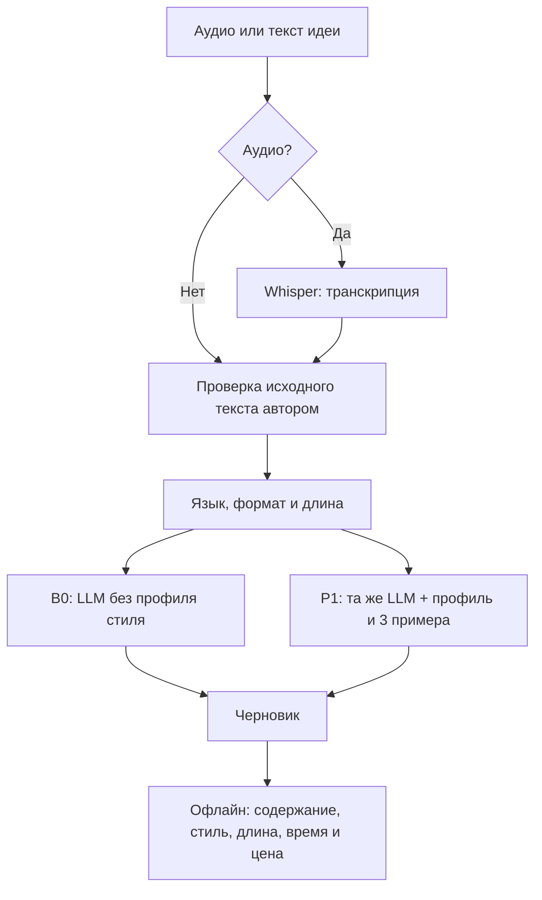

# Voice-to-Blog — дизайн исследовательского PoC

Итерация: ДЗ №2. Основание: [задание](https://gist.github.com/pacifikus/bada0e4b597852e4bb50512daf451929)
и [шаблон дизайн-документа](https://github.com/IrinaGoloshchapova/ml_system_design_doc_ru/blob/main/ML_System_Design_Doc_Template.md).
Результаты EDA вынесены в [отдельный отчет](../reports/hw2/eda_report.ru.md).

## 1. Цель и границы итерации

Первый пользователь и владелец продукта — автор проекта. Система должна помогать
независимому автору превращать неструктурированные идеи в связный текст, сохраняя
смысл и манеру письма. Темы: учеба, работа ML-инженером и личные размышления.

Первая версия ограничена цепочкой **ввод → транскрипция → статическая персонализация
→ один черновик**. Автор проверяет транскрипт, выбирает язык, формат blog/Telegram
и длину: обычно около 300 слов, подробный пост — до 550. Языки EN/RU равноправны.
Интерфейс, редактирование с историей версий, обучение предпочтениям и публикация
отложены. В ДЗ №2 выполнено локальное исследование, а не готовое приложение.

Гипотеза: профиль стиля и примеры текстов повышают соответствие манере автора
без потери исходного смысла. Для бизнеса успех — меньше времени на редактуру;
синтетический эксперимент проверяет только промежуточные признаки этой гипотезы.
Предпочтение реального автора и сокращение времени правок пока не измерены.

Ориентиры будущего PoC: до минуты на обработку идеи и не более $0.20 за запрос
генерации. Полная задержка цепочки еще не проверена; низкая цена ответа сама
по себе не означает приемлемого качества текста.

## 2. Методология

### 2.1. Постановка задачи

Используются две задачи: распознавание речи и условная генерация текста с сохранением
содержания. Единица обработки и оценки — один эпизод автора. Временного горизонта
прогноза нет; результат создается по запросу. Локальное обучение моделей не проводится.

### 2.2. Схема решения

Для сравнения B0/P1 используется одинаковый исходный текст. Ошибки ASR изучаются
отдельно, чтобы не приписывать их персонализации. Офлайн-оценщик не блокирует
пользовательский результат и не выбирает удачные перегенерации.

### 2.3. Этапы решения

#### Этап 1. Подготовка данных

Реальных подготовленных данных нет. Для первого исследования создана конечная
синтетическая партия: шесть вымышленных персон, по три стилевых референса и два
эпизода на персону. Из 12 эпизодов шесть англоязычных и шесть русскоязычных.

**Входы моделей:**

| Сущность | Назначение | Источник и качество |
| --- | --- | --- |
| Разговорный монолог / аудио | Идея автора; источник для генерации / распознавания | Синтетический текст и TTS; аудио не проверено прослушиванием |
| Язык, формат, диапазон слов | Ограничения результата | Заданы в спецификации эпизода |
| Профиль письма и три примера | Контекст персонализации P1 | Явные стилевые правила; события примеров отделены от эпизодов |

**Цели и оценочная разметка:**

| Сущность | Назначение | Ограничение |
| --- | --- | --- |
| Допустимый пост-цель | Пример завершенного выражения идеи | Не единственный правильный ответ; не передается генератору |
| Обязательные тезисы, уточнения и исправления | Проверка сохранения смысла | Размечены по замыслу и исходному тексту; требуют проверки поддержки |
| Предполагаемый скрипт TTS | Референс для сравнения с ASR | Не подтвержден как точная акустическая расшифровка |

**Получение и обработка.** Владелец задает персоны и требования, LLM создает тексты,
а независимые контексты проверяют их. Пост-цель и монолог генерируются раздельно
из общего замысла: генератор монолога не видит пост-цель. Из монологов TTS создает
аудио. Процесс разовый; регулярный поток данных пока не нужен. Тексты и разметка
хранятся в JSON/TXT, аудио — в WAV. Подготовка включает проверку полей, цитат,
порядка исправлений, дублей и пересечения событий. Слова монолога не редактируются
ради более удобного распознавания; направления подачи отделены от текста.

**Выводы EDA.** Баланс персон/языков обеспечен, но учебных эпизодов всего один,
а оба подробных поста находятся только в test. Найденное смысловое пересечение
референса и эпизода устранено заменой эпизода до тестирования. Один неподдержанный
факт в посте-цели удален после аудита. Структурные проверки не заменяют человеческую
проверку содержания. Чистая синтетическая речь ограничивает перенос на реальные записи.

**Недостаток данных.** Следующий шаг — еще 12 эпизодов: 5 учебных, 2 рабочих,
3 личных и 2 смешанных. Это даст по шесть на тему; нужны подробные dev-примеры
на EN и RU. Объем выбран для покрытия сценариев, а не статистической достоверности.
Для проверки пользы автору потребуется отдельный пилот с реальными идеями и правками.

**Конфиденциальность.** В текущем наборе нет реальных личных историй и записей.
Для будущих данных нужны разрешение автора и удаление сведений о третьих лицах
до передачи внешнему провайдеру. Ключи доступа не входят в данные и документы.

**Результат этапа:** проверенный набор с разделением dev/test, описание ограничений
и [EDA с выводами](../reports/hw2/eda_report.ru.md). Данные и экспериментальные
исходники остаются локально и в эту сдачу не включены.

#### Этап 2. Подготовка моделей генерации

**Бейзлайн B0:** hosted LLM получает исходный текст и требования к языку, формату
и длине. **Основной вариант P1:** та же модель дополнительно получает профиль
письма и три референса автора. При таком объеме используются все три примера;
отдельный поиск или embeddings пока не обоснованы. Модель эксперимента — DeepSeek.
Пост-цель, оценочная разметка и биография не входят в контекст генерации.
Факты референсов не разрешают добавлять новые события в черновик.

**Предобработка:** сохранение исходных слов, отделение служебных TTS-тегов,
формирование одинаковых требований B0/P1 и добавление стилевого контекста только
в P1. Веса моделей не меняются, поэтому локальный training loss не оптимизируется.

| Метрика | Зачем нужна |
| --- | --- |
| Покрытие обязательных тезисов | Доля исходных тезисов, сохраненных без искажения; ориентир ≥90% |
| Неподтвержденные факты и важные ошибки | Добавления, отрицания, числа, исправления и неопределенность; цель — отсутствие ошибок |
| Стиль и сохранение смысла, 1–5 | Соответствие явной рубрике персоны; ориентир ≥4, не мнение реального автора |
| Язык, формат и длина | Выполнение запроса; длина проверяется подсчетом слов |
| Время и цена | Связь с ограничениями продукта; учитываются отдельно от качества |

Буквальное сходство с одним постом-целью не является основной метрикой: допустимы
разные корректные формулировки. Сокращение редакторских усилий оценивается позже
непосредственно по времени и объему правок.

**Валидация.** По одному dev- и test-эпизоду каждой персоны, по 3 EN/3 RU в split.
Связанные версии одного события не разделяются между выборками. Проверяются новые
события знакомых авторов, а не перенос на новых людей. Настройки и рубрика фиксируются
на dev до доступа к test. На условие генерируется один ответ; все неудачи остаются
в результатах. Test после оценки не используется повторно для настройки.

**Результаты и интерпретация.** Получены 24 черновика. В каждом split длина выполнена
у B0 в 0/6 случаев, у P1 — в 1/6. Стилевые оценки B0/P1: dev — 4,50/4,83,
test — 4,83/4,67. На test пять ничьих и одно снижение P1: преимущество персонализации
не подтверждено. Источник уже несет речь персоны, поэтому B0 не лишен стилевых сигналов.
Все запросы дешевле $0.20, но это не цена принятого автором текста.

**Развитие и риски.** Главный наблюдаемый риск — превышение длины. Следующая
dev-итерация должна проверить детерминированный контроль длины и ограниченный шаг
сжатия либо другую модель. После расширения корпуса можно сравнить отбор примеров
и настройки промпта. Fine-tuning отложен. Перенос фактов и потеря уточнений требуют
проверки содержания; высокий стиль не компенсирует фактическую ошибку.

**Результат этапа:** определены B0/P1, схема валидации и метрики; получены парные
результаты и решения для следующей итерации. По шести test-эпизодам статистическая
значимость и полезность для реального автора не заявляются.

#### Этап 3. Транскрипция

Сравниваются pretrained Whisper small и large-v3 без обучения на одинаковых записях
и настройках распознавания. Измеряются WER/CER, время и real-time factor — отношение
времени распознавания к длительности аудио; загрузка модели учитывается отдельно.
Язык задан из метаданных. Оба варианта проверены локально на GPU.

WER/CER считают расхождение с предполагаемым скриптом: регистр и пунктуация
нормализуются, числа не переводятся в слова, оговорки и повторы сохраняются.
Без прослушивания расхождение может происходить как из-за TTS, так и из-за ASR.
Важные различия чисел, отрицаний и исправлений нужно разбирать отдельно от WER.

Small быстрее и имеет ниже WER во всех 12 парных эпизодах. Совокупный test WER —
1,84% против 31,16% у large-v3; в нескольких результатах large-v3 появились длинные
повторы. Small — предварительный выбор для PoC, а не доказанный победитель на живой речи.
Для следующих настроек нужны новые dev-записи и проверенные реальные расшифровки.

**Результат этапа:** выбран исходный ASR-вариант и обозначены границы сравнения.
Оба варианта генерации используют общий источник; ASR не смешивается с оценкой стиля.

#### Этап 4. Офлайн-оценка и интерпретация

Независимая от генератора LLM оценивает один черновик, не зная его режима B0/P1.
Ей доступны источник, разметка и рубрика стиля; каждый вывод требует цитаты.
Невалидные ответы исключаются из средних с явным знаменателем, а не превращаются
в нулевые оценки. Оценщик не используется как продуктовый фильтр.

На dev проверены корректные тексты и намеренные добавления, пропуски, обращения
смысла и изменения форматирования. Пройдены 10/12 проверок: изменения только
форматирования вызвали ложные предупреждения о фактах. Отдельный ASR-оценщик
также путал пунктуацию и написание слов с изменением смысла и мог ошибочно считать
пропуск сохраненным тезисом. Корректная цитата не гарантирует правильности вывода.

Поэтому модельные оценки — рекомендательные сигналы для разбора, а не доказательство
фактической точности. Следующей итерации нужны новые контрольные примеры и сверка
с человеческой оценкой. **Результат этапа:** оценки с явными ограничениями,
разбор ошибок и решения; заявления о предпочтении автора отложены до пилота.

## 3. Следующий пилот

После реализации интерфейса автор проверяет несколько реальных записей и вслепую
сравнивает B0/P1 с возможностью ничьей. Измеряются время правок, исправления фактов,
соблюдение требований, задержка и расходы. Размер пилота уточняется по вариативности.
Главные условия перехода — соблюдение длины и сохранение смысла, а не успех API.

## 4. Отложенное развитие

Долгосрочное видение сохраняет редактирование, историю версий, агентное управление
контентом и публикацию с подтверждением. В текущую итерацию они не входят.
