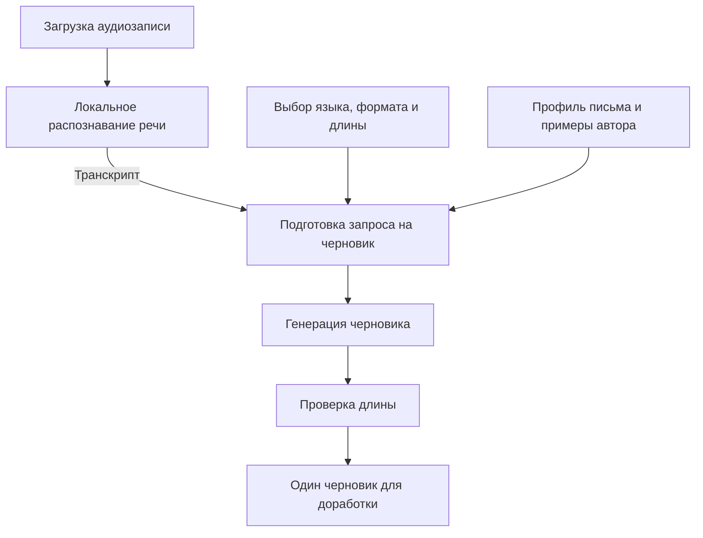

# Дизайн ML-системы — Voice-to-Blog

- **Основной пользователь и владелец продукта:** автор проекта
- **Основная ML-задача:** создание черновика по идее с учетом письменного стиля
- **Вспомогательная ML-задача:** распознавание речи

## 1. Цели и предпосылки

### 1.1. Зачем идем в разработку продукта?

#### Бизнес-цель

Voice-to-Blog должен сократить время между фиксацией идеи и получением черновика,
который автор готов доработать. Первый пользователь — автор проекта. Решение также
подходит независимым авторам, которые пишут об учебе, работе и личных наблюдениях.

Сегодня автору нужно расшифровать запись, выделить главную мысль, собрать структуру
и написать текст. Локальное распознавание речи снимает часть ручной расшифровки.
Языковая модель собирает черновик по транскрипту, а профиль и примеры
помогают передать привычную автору манеру письма.

#### Что считаем успехом

Автор получает один редактируемый черновик и тратит меньше усилий на доведение
его до принятого текста. Проверяем полноту мысли, отсутствие новых неподтвержденных
фактов и выполнение требований к языку, формату и длине. Пользу оцениваем
по времени до принятого текста относительно привычного процесса автора (§ 3).

### 1.2. Бизнес-требования и ограничения

| ID | Требование | Критерий приемки |
| --- | --- | --- |
| BR-01 | Принимать голосовую идею | Автор загружает запись на английском или русском |
| BR-02 | Распознавать речь локально | Транскрипт автоматически передается на генерацию черновика |
| BR-03 | Создавать один черновик по запросу | Автор выбирает язык, формат блога или Telegram и диапазон длины |
| BR-04 | Учитывать стиль автора | При генерации используются заданный профиль письма и примеры |
| BR-05 | Сохранять смысл и ограничения источника | Черновик передает основные тезисы, сохраняет поправки и степень уверенности |
| BR-06 | Сделать качество и расходы измеримыми | Учитываются соблюдение требований, задержка и цена запроса |

Приложение рассчитано на одного пользователя и локальный запуск в Streamlit.
Обычный пост — около 300 слов, подробный — до 550. Ориентир машинной обработки
после загрузки — до 60 секунд суммарно на расшифровку, подбор стилевого контекста
и генерацию. Задержка измеряется от загрузки до получения черновика.
Ориентир цены — до $0.20 за запрос одного черновика.

Распознавание выполняется через `faster-whisper`. Генерация может использовать
внешний API. Автору нужно показать провайдера и какие данные ему передаются.
Автор загружает запись, выбирает параметры поста и получает черновик,
который можно доработать.

### 1.3. Что входит в скоуп проекта

В проект входят загрузка записи, локальная транскрипция, настраиваемые параметры
поста, статический профиль стиля и генерация одного черновика. Оценка на
сохраненных примерах выполняется отдельно от приложения.

За границами проекта остаются история версий и согласование, планирование
и публикация, издательские интеграции, обучение на правках, дообучение моделей,
работа с изображениями и многопользовательский режим.

Для воспроизводимой оценки фиксируются состав выборки, версии моделей, параметры,
промпты и результаты. Расчеты повторяются по сохраненным ответам. Для будущего
развертывания отдельно проверяются работа на целевом оборудовании и стоимость
обработки длинного аудио.

### 1.4. Предпосылки решения

- Автор задает профиль письма и подбирает несколько принятых текстов. Их факты
  относятся к другим событиям. Фактический источник нового поста — идея автора.
- Результат создается по запросу. Единица обработки — одна идея с заданным
  форматом, языком и диапазоном длины.
- Для оценки используются синтетические события с размеченными тезисами. Эффект
  на стиль реального автора и редакторские усилия проверяется в пилоте.

## 2. Методология

### 2.1. Постановка задачи

**Распознавание речи.** Из записи на английском или русском модель получает
транскрипт для генерации черновика.

**Условная генерация.** Языковая модель получает транскрипт,
требования к посту, профиль письма и примеры автора. Результат — один черновик
для выбранного формата. Содержание опирается на идею. Профиль и примеры задают
тон, структуру и степень детализации.

### 2.2. Блок-схема решения

Транскрипт автоматически поступает на подготовку запроса вместе с параметрами
поста и стилевым контекстом. Если черновик выходит за указанный диапазон,
интерфейс показывает фактическое число слов и сообщает об отклонении.

### 2.3. Этапы решения задачи

#### Этап 1. Подготовка данных

##### Выбор источника данных

Подготовленных записей и пар «идея → готовый пост» от реальных авторов пока нет.
Для разработки выбрали синтетические данные на основе вымышленных авторов — персон.
Каждой персоне задали язык, круг интересов, явные признаки письменного стиля и
манеру устной речи. Это позволяет моделировать разные ситуации и отделить
устную подачу от того, как персона пишет готовый пост. У двух персон в монологах
предусмотрены сбивчивость, повторы, эмоциональные реакции и самоисправления.

##### Как создан набор

1. **Карточки персон и примеры стиля.** Модели OpenAI через субагентов Codex
   с отдельным контекстом генерировали тексты по шаблонам промптов. Для каждой
   персоны подготовили три примера письма о событиях, отличных от эпизодов набора.
   Точные идентификаторы моделей и настройки этих запусков не зафиксированы.
2. **Замысел и два независимых текста.** Для эпизода задавали ситуацию, обязательные
   тезисы, дополнительные детали и требования к посту. Из этого замысла в разных
   контекстах генерировали разговорный монолог и один допустимый готовый пост.
   Генератор монолога не получал готовый пост.
3. **Проверка текста.** Отдельный субагент сверял факты поста с монологом и проверял
   смысловое пересечение событий. Python-валидатор проверял структуру, наличие
   обязательных полей, точность цитат, порядок исправлений и точные дубли.
   Аудит выявил один близкий сюжет в эпизоде и стилевом примере, поэтому эпизод
   заменили. Из другого поста удалили деталь, которой не было в монологе.
4. **Синтез аудио.** Через коннектор ElevenLabs MCP модель `eleven_v4` озвучивала
   монологи готовыми голосами, по одному голосу на персону. Указания по подаче
   добавлялись отдельно от произносимого текста. Длинные монологи разделяли на
   фрагменты, каждый фрагмент озвучивали один раз. Python-скрипт соединял их в WAV.
   Прослушивание не проводилось. Сценарии озвучки служат предполагаемыми
   расшифровками.

##### Состав готового набора

В наборе шесть персон, по три на английском и русском, и 12 эпизодов, по два на
персону. В каждом эпизоде зафиксированы замысел, язык, формат поста и диапазон длины.

| Входы | Что подготовлено | Для чего нужны |
| --- | --- | --- |
| Голосовые идеи | 12 WAV-записей общей длительностью 70,33 минуты | Вход для распознавания речи |
| Требования к посту | Язык, формат и диапазон слов для каждого эпизода | Параметры генерации |
| Стилевой контекст | 6 карточек персон и 18 постов-примеров | Тон, структура и манера письма |

| Цели и оценочная разметка | Что подготовлено | Для чего нужны |
| --- | --- | --- |
| Предполагаемые расшифровки | 12 разговорных монологов без указаний по подаче | Ориентир при проверке распознавания |
| Допустимые готовые посты | 12 текстов по тому же замыслу | Примеры структуры и выражения мысли |
| Тезисы и доказательства | 124 тезиса, из них 118 обязательных, с привязкой к фрагментам монолога | Проверка сохранения смысла, уточнений и исправлений |

Тексты и разметка сохранены в TXT и JSON, озвучка — в WAV. Синтетический набор
создан отдельной партией. В продукте записи и параметры поступают по запросу,
а профиль и образцы письма автор обновляет вручную.

##### Покрытие и ограничения

В наборе поровну эпизодов на EN и RU, но всего один эпизод про учебу и два
подробных поста. Еще 12 эпизодов доведут покрытие до шести на тему, если добавить
пять учебных, два рабочих, три личных и два смешанных. Среди них нужны подробные
посты на обоих языках. Для оценки на естественной речи потребуются реальные
записи и расшифровки, сверенные с аудио. Подробный анализ и графики приведены
в [отчете EDA](../reports/hw2/eda_report.ru.md).

##### Конфиденциальность и результат этапа

В наборе вымышленные истории и синтетические голоса. Реальные записи, авторские
тексты и ключи доступа хранятся вне публичного репозитория. При передаче контекста
внешнему провайдеру автору показывается состав отправляемых материалов. Лишние
сведения о третьих лицах удаляются.

На выходе этапа — проверенный синтетический набор с входами и разметкой,
перечень пробелов в покрытии и требования к материалам пилота.

#### Этап 2. Подготовка моделей и критериев качества

##### Исходная конфигурация и предобработка

| Компонент | Бейзлайн для разработки | Предобработка и результат |
| --- | --- | --- |
| Распознавание | Локальный Whisper small через `faster-whisper` с заданным языком записи | Аудио декодируется в моно 16 кГц. Из полученного транскрипта при подготовке входа сохраняются числа, отрицания и самоисправления |
| Генерация | Один запрос к предобученной LLM с поддержкой EN/RU, фиксированным промптом, профилем письма и выбранными автором примерами | Транскрипт, параметры поста и стилевой контекст передаются отдельными блоками. Ответ разбирается как один черновик и проверяется на пустой текст и длину |

Эта конфигурация дает отправную точку для оценки улучшений. Для оценки пользы
продукта отдельный ориентир — привычный ручной процесс автора (§ 3).
Модели используются с фиксированными весами. WER, доля сохраненных тезисов
и стиль служат метриками проверки. Локальная функция потерь не задается,
поскольку проект настраивает параметры распознавания и вход генератора.

##### Метрики и их назначение

| Что оценивается | Метрика и связь с задачей |
| --- | --- |
| Распознавание | WER/CER — сумма замен, вставок и удалений относительно числа слов или символов в эталоне. Показывают точность на разных языках. Смысловые потери разбираются отдельно, поскольку пропущенное отрицание может стоить дороже нескольких орфографических ошибок |
| Содержание черновика | Доля сохраненных обязательных тезисов и число неподтвержденных утверждений. Вместе показывают, что модель сохранила из записи и какие факты добавила |
| Соответствие стилю | Оценка 1–5 по тону, структуре и другим наблюдаемым признакам профиля автора. Один и тот же замысел допускает разные формулировки |
| Выполнение запроса | Доля черновиков, соблюдающих язык, формат и диапазон слов. Длина проверяется подсчетом слов, язык и структура — по требованиям к результату |
| Время, стоимость и полезность | Время распознавания на минуту аудио, задержка каждой стадии и всей цепочки, цена генерации и время правок. Эти показатели связывают работу моделей с условиями пилота (§ 3) |

##### Схема валидации

Примеры для настройки и итоговой проверки разделяются по событиям. Связанные
версии остаются в одной части, а образцы стиля описывают отдельные события.
В проверке учитываются язык, длительность аудио, сбивчивость речи, формат
и длина поста. При одинаковых персонах в обеих частях выводы относятся к новым
идеям известных авторов. Для оценки переноса нужны отдельные авторы.

1. **ASR отдельно.** Транскрипт сопоставляется с расшифровкой, сверенной с записью.
   Для расчета WER/CER в обоих текстах одинаково нормализуются регистр, пунктуация
   и пробелы. Синтетический скрипт дает предварительную оценку расхождения,
   которое может включать особенности озвучки.
2. **Генерация отдельно.** На вход подается проверенная расшифровка. Черновик
   оценивается по тезисам, требованиям и рубрике стиля. Так можно обнаружить
   ошибки генератора при корректном входе.
3. **Сквозная проверка.** Генерация использует автоматический транскрипт,
   как в продукте. Черновик сверяется с исходной записью. Измеряются задержка
   от загрузки, цена генерации и доля успешно обработанных записей. Сбои ASR,
   ошибки API и пустые ответы учитываются среди всех попыток.

Итоговый набор используют после выбора параметров. Если по результатам меняется
конфигурация, для следующей итоговой проверки нужны новые события.

##### Разбор ошибок и развитие моделей

При разборе проблемного поста сопоставляются аудио, транскрипт и черновик.
Если отрицание исчезло из транскрипта, источник ошибки — распознавание. Если
транскрипт сохранил отрицание, а черновик изменил смысл, исправления нужны на стадии
генерации. Результаты рассматриваются по отдельным случаям и по срезам. Это
помогает отличить ошибку модели от недостатка покрытия или ошибки оценщика.

| Риск или наблюдаемая проблема | Изменение и способ проверки |
| --- | --- |
| Распознавание теряет фрагменты или повторяет их | Сравнить размер Whisper, разбиение длинной записи и параметры декодирования. Проверить важные пропуски, время и расход памяти |
| Генератор выходит за диапазон слов | Сравнить ограничения промпта и один проход сокращения. Снова проверить обязательные тезисы и измерить дополнительную задержку |
| Стилевой контекст влияет на факты черновика | Уточнить границу между транскриптом и образцами письма. При большой библиотеке выбирать примеры по языку и формату |
| Слабое качество на одном языке или формате | Сравнить модели генерации, температуру и ограничение объема ответа на одинаковых входах. Учитывать цену и задержку |
| Автоматический оценщик путает форму со смыслом | Проверять спорные примеры вручную и использовать отдельные контрольные искажения (§ 2.3, этап 4) |

##### Результат этапа

На выходе этапа — исходные конфигурации ASR и генерации, правила предобработки,
метрики и схема валидации. По этому протоколу проверяются конфигурации,
из которых на этапе 3 выбирается вариант для прототипа.

#### Этап 3. Интерпретация результатов и выбор конфигурации

По протоколу этапа 2 разбираются успешные и проблемные случаи. Для каждого
случая сопоставляются запись, транскрипт и черновик, чтобы понять, на какой
стадии возникла ошибка. Например, если расшифровка сохранила уточнение,
а черновик его потерял, нужно доработать генерацию. Разбор охватывает оба
языка, разную длительность записи и разные форматы поста.

С автором согласуется, какие ошибки меняют смысл и требуют правки. Из таких
случаев формируются проверочные примеры. Среди конфигураций, которые
удовлетворяют критериям содержания и формата, выбирается вариант с подходящей
задержкой и стоимостью. Если ни один вариант не удовлетворяет критериям,
фиксируются причины и повторяется проверка после исправления.

**Результат этапа.** Выбранные модели и настройки для прототипа, обоснование
выбора и примеры для проверки существенных ошибок.

#### Этап 4. Правила проверки черновика и приемки

В приложении автоматически проверяются наличие текста и диапазон слов.
Ошибка распознавания или пустой ответ генератора отображаются как сбой.
Если текст выходит за диапазон, автор видит черновик, фактическое число слов
и сообщение об отклонении. Такой ответ учитывается как нарушение требования
к длине.

На пилоте содержание проверяется по записи и обязательным тезисам, стиль —
по профилю автора, а полезность — по времени и объему правок. Критерии приведены
в § 3.2. Офлайн-оценщик может предложить случаи для разбора. Его суждения
сверяются с источником, а сам оценщик проверяется на контрольных пропусках,
искаженных числах и безвредных изменениях форматирования.

**Результат этапа.** Правила обработки ошибок и выдачи черновика, критерии
приемки и способы их измерения.

#### Этап 5. Реализация сквозного прототипа

В Streamlit подключаются загрузка записи и локальный Whisper. Транскрипт
автоматически передается генератору. Запрос объединяет его с выбранными языком,
форматом и длиной, профилем письма и примерами автора. Интерфейс применяет
правила этапа 4 и показывает один черновик для доработки.

Проверяются записи на EN и RU, оба формата поста, разные диапазоны длины
и сбои распознавания или генерации. Причина сбоя показывается автору,
который может повторить запрос. На целевой конфигурации измеряются время
от загрузки до черновика и цена генерации. Задержка распознавания, подготовки
контекста и генерации измеряется отдельно, чтобы найти узкое место.

**Результат этапа.** Рабочий прототип, проверенные сквозные сценарии и замеры
задержки, стоимости и доли успешных запросов.

#### Этап 6. Пилот и решение о готовности

Автор использует прототип на реальных голосовых идеях по процедуре из § 3.1.
Для каждого случая оцениваются сохранение смысла, соответствие запросу
и затраты на правки. Время от идеи до принятого текста сравнивается
с привычным процессом на сопоставимых идеях. Решение принимается по заранее
согласованным критериям § 3.2 с учетом размера выборки и разобранных ошибок.

**Результат этапа.** Краткий отчет для владельца продукта с измерениями,
типичными ошибками и решением о готовности. Если критерии не достигнуты,
отчет определяет, что нужно доработать и повторно проверить.

## 3. Подготовка пилота

### 3.1. Способ оценки

Автор записывает голосовые идеи и заранее выделяет ключевые тезисы. После генерации
он сверяет черновик с записью и дорабатывает его до принятого текста. Фиксируются время всего
процесса и время редакторской работы. Польза оценивается относительно привычного
процесса автора на сопоставимых идеях.

Стартовый объем — три записи по 5–10 минут и подборка примерно из 12 реальных
идей. Окончательный размер зависит от вариативности результатов.

### 3.2. Что считаем успешным пилотом

| Метрика | Ориентир |
| --- | --- |
| Время от идеи до принятого текста | Меньше, чем в привычном процессе автора |
| Необходимая редактура | Измеряются время работы с черновиком и объем изменений |
| Сохранение ключевых тезисов | Не менее 90% без искажения |
| Неподтвержденные факты | 0 на проверенной выборке |
| Язык, формат и длина | Не менее 95% черновиков удовлетворяют применимым требованиям |
| Задержка и цена | До 60 секунд машинной обработки типичной идеи и до $0.20 за запрос генерации |

Целевое сокращение времени согласуется перед пилотом после замера привычного
процесса. Польза оценивается при сохранении смысла и выполнении требований к посту.

### 3.3. Подготовка и вычисления

Перед пилотом измеряются время распознавания, подготовки контекста и генерации,
а также задержка всей цепочки от загрузки до черновика. Вызовы
офлайн-оценщика учитываются отдельно от пользовательских запросов. Перед выбором
облачного размещения время распознавания измеряется на целевом оборудовании.

## 4. Риски и открытые решения

| Риск | Мера снижения |
| --- | --- |
| Расшифровка меняет смысл идеи | Проверка распознавания на размеченных записях и сверка черновика с аудио в пилоте |
| Генератор превышает длину | Подсчет слов и явное сообщение об отклонении |
| Стилевые примеры переносят чужие факты | Разделение источника и профиля и проверка утверждений по исходной идее |
| Автоматическая оценка искажает вывод о качестве | Контрольные случаи и ручная проверка |
| Локальные замеры не переносятся на облако | Повторить замеры на целевой конфигурации до выбора инфраструктуры |
| Внешнему сервису передаются лишние сведения | Проверять состав отправляемого контекста и удалять лишние сведения о третьих лицах |

Перед пилотом уточняются состав реальных материалов, конфигурация целевого
оборудования и объем сокращения редакторского времени, который имеет значение
для автора.
