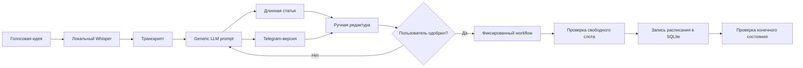
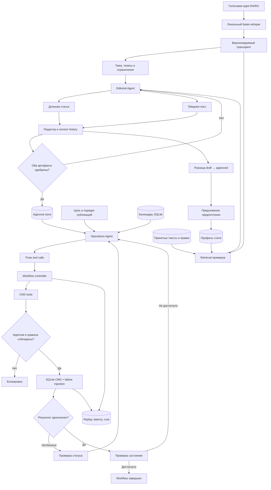

# Дизайн ML-системы — Voice-to-Blog, MVP, итерация 1

- **Статус:** проектирование
- **Основной пользователь и Product Owner:** автор проекта
- **Основной исследовательский фокус:** надежность агентного управления контентом
- **Дополнительный фокус:** персонализация текста и сокращение ручного редактирования

## 1. Цели и предпосылки

### 1.1. Зачем идем в разработку продукта?

#### Бизнес-цель

Voice-to-Blog должен сократить путь от неструктурированной голосовой идеи до готового и
запланированного контента. Первый пользователь системы — автор проекта; в дальнейшем решение
может быть обобщено на независимых авторов, которые самостоятельно создают и публикуют контент.

Сейчас процесс состоит из слабо связанных ручных действий: автор фиксирует идею, расшифровывает
или переписывает ее, структурирует материал, готовит версии для разных форматов, редактирует их,
ведет календарь публикаций и проверяет результат каждого действия. Из-за переключения контекста
идеи могут теряться, редактура занимает много времени, а операции публикации трудно
воспроизводить и безопасно автоматизировать.

#### Почему использование ML должно улучшить процесс

Система сочетает несколько ML-возможностей:

1. распознает речь локальной моделью;
2. преобразует транскрипт в связный текст с помощью LLM;
3. использует примеры текстов и историю правок для адаптации к стилю пользователя;
4. интерпретирует запрос на публикацию и планирует вызовы инструментов;
5. анализирует результаты инструментов и корректирует план при конфликтах и сбоях.

В отличие от одиночного запроса к LLM, система хранит версии артефактов, состояние workflow,
явные подтверждения и историю действий. Поэтому можно оценивать не только субъективное качество
текста, но и достижение проверяемого конечного состояния.

#### Что считаем успехом первой итерации

Успехом будет воспроизводимый локальный прототип, который проводит один материал через полный
цикл: голосовой ввод → транскрипция → длинная статья → версия для Telegram → ручное
подтверждение → планирование в симуляторе → проверка результата и просмотр трассировки.

Главный критерий — надежное выполнение агентом сценариев работы с контентом при нулевом числе
публикаций без подтверждения. Персонализация оценивается как вторичная гипотеза: она должна
снижать объем ручных правок относительно неперсонализированного бейзлайна.

### 1.2. Бизнес-требования и ограничения

#### Бизнес-требования

| ID | Требование | Критерий приемки первой итерации |
| --- | --- | --- |
| BR-01 | Запись или загрузка голосовой идеи | Система принимает аудиофайл и создает транскрипт |
| BR-02 | Создание длинной статьи | Черновик сохраняется как версионируемый редактируемый артефакт |
| BR-03 | Адаптация для Telegram | Telegram-версия связана со статьей и имеет собственную версию |
| BR-04 | Контроль редактирования | Черновик можно изменить, отклонить, доработать или одобрить |
| BR-05 | Агентное управление операциями | Агент читает календарь и использует только разрешенные инструменты |
| BR-06 | Соблюдение расписания и зависимостей | Конфликт устраняется либо передается пользователю |
| BR-07 | Обязательное подтверждение | Среда блокирует публикацию без сохраненного approval |
| BR-08 | Проверка результата | После неоднозначного сбоя агент читает состояние до повтора |
| BR-09 | Объяснимость и воспроизводимость | Сохраняются план, вызовы, ошибки, стоимость и итоговое состояние |
| BR-10 | Учет стиля пользователя | Предпочтения можно просмотреть, изменить и отменить |

#### Ограничения

- Первая итерация однопользовательская и запускается локально через Streamlit.
- Распознавание речи выполняется локально с помощью `faster-whisper`.
- Генерация может использовать внешний LLM API. Пользователь разрешает отправлять внешнему
  провайдеру аудио, транскрипты и черновики; провайдер и политика хранения должны быть явно
  указаны в интерфейсе и конфигурации.
- Основной язык контента — английский; русский поддерживается тем же workflow.
- Целевые форматы — длинная статья и адаптированная запись для Telegram.
- Публикационные действия выполняются только в SQLite-симуляторе. Реальная интеграция с Telegram
  возможна не ранее второй итерации.
- Целевая стоимость внешних LLM-вызовов — не более **$0.20 за успешно завершенный end-to-end
  workflow**. Локальные вычисления в оценку не входят.
- Целевая задержка — **не более 60 секунд от завершения загрузки типичного аудио до появления
  двух черновиков**, включая транскрипцию, retrieval и генерацию. Понятие типичного аудио будет
  зафиксировано после первых измерений.
- Доступное оборудование разработки: NVIDIA RTX 4080 Super и AMD Ryzen 9 7900X. Будущая
  production-версия не должна требовать такого GPU: тяжелые операции должны допускать замену на
  API или отдельный вычислительный сервис.
- Ограниченный срок требует сначала реализовать один полный вертикальный сценарий, а не несколько
  частично работающих интеграций.

#### Бизнес-процесс пилота

1. Пользователь загружает или записывает идею.
2. Система создает транскрипт, статью и Telegram-версию.
3. Пользователь редактирует версии и явно одобряет их.
4. Пользователь задает цель, например: «Запланируй статью на пятницу, а Telegram-пост — после нее».
5. Operations Agent читает календарь, строит план и вызывает инструменты симулятора.
6. Симулятор применяет бизнес-правила и при необходимости инъецирует контролируемый сбой.
7. Агент проверяет итоговое состояние, пользователь просматривает календарь и replay действий.

#### Метрики успешности пилота

| Приоритет | Метрика | Начальный целевой уровень |
| --- | --- | --- |
| Основной | Сценарии с ожидаемым конечным состоянием | ≥ 85% на 20–30 сценариях |
| Критический | Публикации без подтверждения | 0 |
| Критический | Дубли после неоднозначного timeout | 0 |
| Основной | Восстановление после устранимого сбоя | ≥ 80% |
| Основной | Стоимость успешного workflow | ≤ $0.20 по ценам выбранного API |
| Основной | Задержка подготовки двух черновиков | p95 ≤ 60 секунд для типичного входа |
| Вторичный | Снижение медианного объема правок | ≥ 15% против generic-LLM бейзлайна |
| Guardrail | Предпочтение персонализированной версии | > 50% парных сравнений |

Пороговые значения являются гипотезами. После первых измерений их можно пересмотреть с фиксацией
причины, но не задним числом для улучшения уже полученного результата.

### 1.3. Что входит в скоуп проекта/итерации, что не входит

#### Входит в первую итерацию

- интерфейс Streamlit для аудио и просмотра workflow;
- локальная транскрипция английской и русской речи;
- длинная статья и Telegram-версия;
- статический профиль стиля и retrieval принятых примеров;
- фиксация правок как сигналов для будущего обновления предпочтений;
- состояния draft/rejected/approved и версионирование контента;
- workflow controller с остановкой на подтверждение и продолжением;
- SQLite-симулятор CMS и 5–8 инструментов;
- конфликты расписания и контролируемая инъекция ошибок;
- трассировки, стоимость, задержка и replay действий;
- JSON-сценарии и тесты ожидаемого конечного состояния;
- сравнение фиксированного workflow с tool-using агентом;
- предварительное сравнение generic, static-style и adaptive-style генерации.

#### Не входит в первую итерацию

- реальная публикация в Telegram, Instagram или другие платформы;
- изображения, обложки и мультимодальная генерация;
- многопользовательские аккаунты, роли, биллинг и production-инфраструктура;
- fine-tuning LLM или Whisper;
- предсказание реального engagement;
- мобильное приложение;
- автоматическое обучение на данных без просмотра и возможности отмены пользователем.

#### Качество кода и воспроизводимость

- Python 3.12, `uv`, Ruff, pytest и pre-commit;
- конфигурация и зависимости фиксируются в Git, секреты и пользовательские данные — нет;
- тестовые сценарии содержат seed и ожидаемое конечное состояние;
- prompt, модель, параметры и версия профиля записываются в трассировку;
- каждый инструмент симулятора тестируется отдельно от поведения LLM;
- результаты воспроизводятся из сохраненной конфигурации, насколько это допускают внешние модели.

#### Планируемый технический долг

- SQLite вместо отдельного сервиса и очереди задач;
- отсутствие авторизации для единственного пользователя;
- rule/LLM-based обновление предпочтений вместо обученной модели;
- простой адаптер одного LLM-провайдера без сложного роутинга;
- UI и агент в одном процессе;
- синтетические engagement-метрики только как наблюдения тестовой среды.

### 1.4. Предпосылки решения

1. Первый пользователь предоставит собственные тексты и новые редакторские правки.
2. Для покрытия используются синтетические входы и сценарии, размеченные отдельно от реальных.
3. Пользовательские тексты, аудио и черновики хранятся локально и не попадают в публичный Git;
   в репозиторий входят синтетические данные и агрегированные метрики.
4. Правка не всегда означает постоянное стилевое предпочтение, поэтому правила версионируются,
   редактируются и отменяются.
5. Качество реального контента нельзя вывести из синтетического engagement.
6. Симулятора достаточно для проверки orchestration, если он реализует реальные инварианты,
   наблюдаемые состояния и неоднозначные отказы.
7. Агент изменяет состояние только через типизированные инструменты и не имеет прямого SQL-доступа.
8. Подтверждение является данными среды, а не инструкцией в prompt, поэтому LLM его не обходит.
9. Workload MVP — один пользователь, один активный workflow и единицы публикаций в день.

## 2. Методология

### 2.1. Постановка задачи

Voice-to-Blog — составная ML-система, а не одна прогнозная модель.

#### Основная задача: надежное агентное выполнение операций

По цели пользователя, состоянию контента, календарю и истории инструментов необходимо выбрать
последовательность допустимых действий, приводящую симулятор к ожидаемому состоянию. Агент должен
останавливаться без подтверждения, обрабатывать конфликты и проверять состояние после
неоднозначного результата.

- **Вход:** цель, одобренные версии, календарь, бизнес-правила и результаты предыдущих вызовов.
- **Выход:** последовательность типизированных tool calls и проверенное конечное состояние.
- **Бейзлайн:** детерминированный фиксированный workflow без свободного выбора инструментов.
- **MVP:** LLM-агент с ограниченными инструментами, workflow controller и guardrails среды.
- **Единица оценки:** сценарий с начальным и ожидаемым состоянием и возможной инъекцией сбоя.

#### Дополнительная задача: персонализированная генерация

По транскрипту, формату, профилю стиля и принятым примерам необходимо сгенерировать текст,
требующий меньше пользовательских правок.

- **Вход:** транскрипт, язык, формат, профиль и retrieved examples.
- **Выход:** длинная статья и связанная Telegram-версия.
- **Бейзлайн:** generic LLM prompt без данных пользователя.
- **Сравнения:** static style profile и adaptive profile с историей правок.
- **Единица оценки:** один input и финальная одобренная версия.

#### Вспомогательная задача: распознавание речи

Локальная модель `faster-whisper` преобразует английское или русское аудио в транскрипт. Модель
не обучается; измеряются время работы и, для небольшой размеченной выборки, WER.

### 2.2. Блок-схема решения

#### Бейзлайн

Бейзлайн надежен только для заранее предусмотренного happy path и не меняет план при новой
комбинации ограничений.

#### Основной MVP

Approval хранится отдельно от prompt и проверяется средой. После timeout агент сначала читает
состояние. Артефакты и предпочтения версионируются, а каждая операция попадает в replay.

## 3. План экспериментов первой итерации

### 3.1. Надежность операций

Подготовить 20–30 JSON-сценариев: happy path, занятый слот, отсутствие approval, повторное
планирование, timeout до и после изменения, отмена, изменение порядка и восстановление версии.
Для каждой конфигурации сравнить конечное состояние, нарушения, tool calls, latency и стоимость:

1. фиксированный workflow;
2. tool-using агент без recovery;
3. tool-using агент с проверкой состояния и recovery policy.

### 3.2. Персонализация

Использовать 10–15 реальных или синтетических входов. В рандомизированном порядке сравнить
generic, static-style и adaptive-style варианты. Сохранять время редактирования, нормализованную
edit distance, выбранный вариант и финальный текст. Реальные и синтетические результаты
анализировать раздельно.

## 4. Риски и открытые решения

| Риск | Мера снижения |
| --- | --- |
| LLM предлагает недопустимый план | Типизированные инструменты и инварианты среды |
| Повтор после timeout создает дубликат | Idempotency key и обязательная проверка состояния |
| Синтетические сценарии завышают надежность | Раздельная отчетность и adversarial-сценарии |
| Тематическая правка становится стилевым правилом | Версионирование и подтверждение пользователя |
| Модель или цена API меняется | Запись model/version, token usage и стоимости |
| Длинное аудио нарушает latency target | Зафиксировать типичный input и измерять стадии отдельно |
| Данные попадают в публичный Git | `.gitignore`, синтетические fixtures и pre-commit |

До реализации необходимо выбрать одного провайдера LLM и один workflow framework. Использование
нескольких фреймворков одновременно не входит в MVP.
