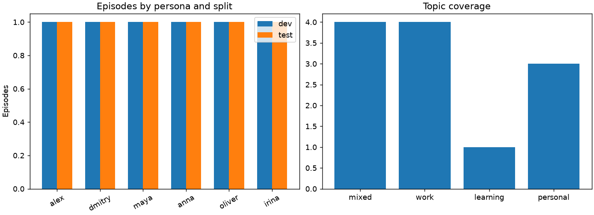
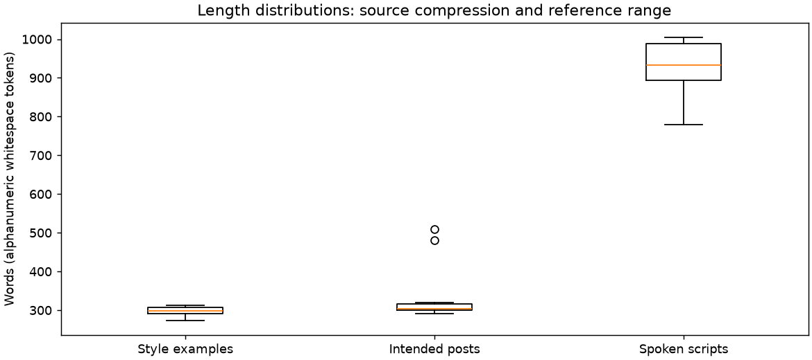
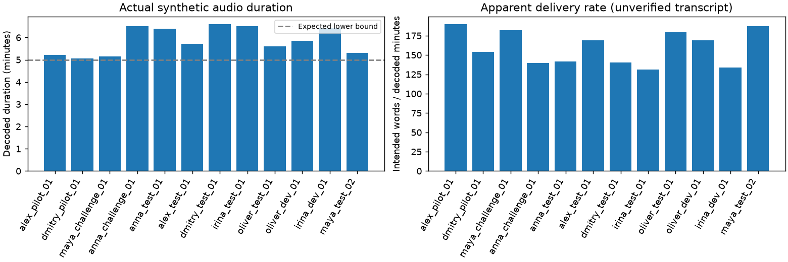

# EDA: данные Voice-to-Blog

Анализ выполнен 16.11.2026 для локального синтетического набора. В сдачу включены
выводы и три графика; исходные тексты, аудио и экспериментальный код не публикуются.
Отчет не является пакетом для независимого повторного расчета без этих данных.

## 1. Состав и объем

| Компонент | Объем |
| --- | ---: |
| Вымышленные персоны | 6 |
| Стилевые референсы, по три на персону | 18 |
| Эпизоды, по два на персону | 12 |
| Посты-цели / разговорные монологи | 12 / 12 |
| Разделение dev / test | 6 / 6 |
| Языки EN / RU | 6 / 6 эпизодов |
| Синтетические аудиозаписи | 12, всего 70,33 минуты |

Всего 42 активных текста: 18 референсов, 12 целей и 12 монологов. Версии и аудиты
не считаются отдельными наблюдениями. Реальные записи и пользовательские оценки
не собраны; единица модельного сравнения — эпизод.

**Вывод:** баланс языков и персон обеспечен, но темы не сбалансированы: смешанная —
4, работа — 4, личное — 3, учеба — 1. Форматы blog/Telegram — 7/5. Учебный срез
нельзя оценить надежно по одному примеру. Одинаковые персоны в dev/test позволяют
проверить новые события знакомых авторов, но не перенос на новых людей.

## 2. Длины текстов

Референсы — 273–312 слов; десять коротких целей — 292–320, две подробные — 481
и 510. Монологи — 779–1005 слов, в среднем 926. Слово считается элементом после
разделения по пробелам, содержащим хотя бы одну букву или цифру.

**Вывод:** задаче требуется сжатие исходной речи с сохранением смысла. Длина должна
проверяться относительно запроса, а не единого лимита. Оба подробных случая попали
в test; это стресс-срез, который не был настроен на dev. Следующей итерации нужны
подробные dev-примеры на обоих языках.

## 3. Качество, разметка и пересечения

- Размечены 124 тезиса, 118 обязательных; на эпизод — 8–12 обязательных тезисов.
  Есть 81 отдельная необязательная деталь и 8 явных исправлений.
- В активной версии не обнаружены пропущенные обязательные поля, неверные
  обязательные цитаты или нарушенный порядок исправлений.
- Нормализованных точных дублей и семейств, пересекающих dev/test, нет.
- Смысловой аудит нашел сходный сюжет в референсе и новом эпизоде на разных языках.
  Эпизод заменен до модельного тестирования. В одной цели удален неподдержанный факт.
- Четыре эпизода включают более неструктурированную, эмоциональную речь; остальные
  восемь — обычную. Текстовые признаки не подтверждают реализм синтезированных запинок.

**Вывод:** проверки структуры и буквальных дублей недостаточно. Нужны смысловое
сравнение событий и проверка, что каждый факт цели прозвучал в источнике. Число
тезисов не увеличивает размер независимой выборки. Аудит LLM тоже может ошибаться.

## 4. Аудио

Длительность записей — 5,06–6,60 минуты; использованы шесть готовых голосов TTS.
Каждый фрагмент создан с одной попытки; фрагменты соединены в полные записи.
Ручное прослушивание не проводилось. Скрипты — предполагаемые, а не подтвержденные
акустические расшифровки.

**Вывод:** нижняя часть целевого диапазона 5–10 минут представлена, но записей
ближе к десяти минутам нет. Нет реального микрофонного шума и разнообразия голосов.
WER/CER могут включать отклонения синтеза и стыки, а не только ошибки распознавания.
Нельзя переносить результаты на спонтанную речь реального автора.

## 5. Решения по результатам EDA

1. Добавить 12 эпизодов: 5 учебных, 2 рабочих, 3 личных и 2 смешанных — по шесть
   на тему. Среди новых dev-примеров предусмотреть подробные EN/RU-посты.
2. Проверять длину отдельно от содержания и стиля; сохранять ошибки модели
   в итогах, а не выбирать удачные ответы.
3. Разделять ASR и персонализацию в эксперименте; фиксировать настройки до test
   и не использовать просмотренный test для дальнейшей подстройки.
4. Для проверки пользы провести отдельный пилот на реальных идеях с оценкой автора
   и измерением времени правок. Расширение синтетики не заменяет этот пилот.

Предложенные объемы дают покрытие сценариев, а не статистически обоснованный минимум.
